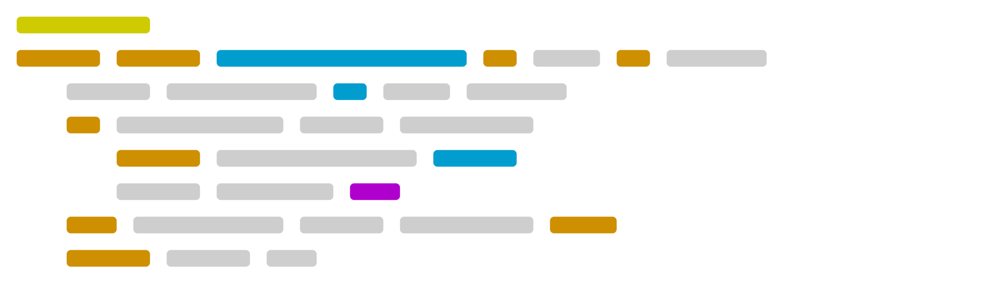

<!---
    Hey there, I'm Malte Verhoeff!
    Happy to see you here exploring my README code
    Feel free to inspire!
    
    But may I please ask you to follow me in return? Just a click!
--->

 

<h1 align="center" >Heyo, I'm Malte !</h1>

<h3 align="center" >Software Engineer - Product Manager - Student</h3>  
<!---

--->

<h1 align="left"> About Me:</h1>

<h4>🎓 I'm a computer science student @️  and product manager @ Checkmk.<h4/>
<h4>✨ I'm interested in deep learning, simulation and design.<h4/>
<h4>🔭 Currently looking into numerical programming.<h4/>
<h4>👥 I’m always open to new projects and collaborations, so feel free to reach out!<h4/>
<h4>🏡 When I’m not working on tech, you’ll usually find me watching films and series, playing video games, or out with my camera.<h4/>

<h1 align="left"> Featured</h1>

🚧🚧🚧 Under Construction 🚧🚧🚧

<h1 align="left"> Socials</h1>

<h1 align="left"> Skills</h1>

